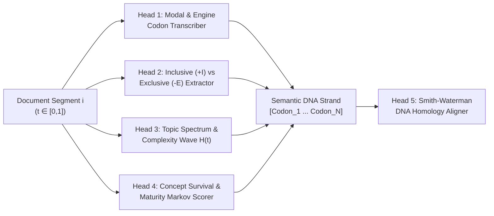

# Implementation Plan 05: Semantic DNA Reading Head & Multi-Head Gluon Transformer

**Date**: 2026-10-24  
**Project Folder**: [`e:\Vector Field Theory\VFT Docs\_Navigation\master_index_plans`](file:///e:/Vector%20Field%20Theory/VFT%20Docs/_Navigation/master_index_plans)  
**Target Engine Directory**: [`e:\Vector Field Theory\VFT Docs\_VFT MD\Physics\semantic_gluon_dna`](file:///e:/Vector%20Field%20Theory/VFT%20Docs/_VFT%20MD/Physics/semantic_gluon_dna)  

---

## 1. Strategic Assessment: Why 1 Multi-Head Local Engine Beats 5 LLM Subagents

| Dimension | 5 Separate LLM Subagents (Bad / High Waste) | 1 Unified 5-Head Python Engine (Smart / Zero Token Waste) |
| :--- | :--- | :--- |
| **Token Cost** | ~250,000+ tokens (5 agents $\times$ full context + reading 4,650 lines of Markdown). | **0 LLM API tokens** after writing the script; runs 100% locally in Python. |
| **Consistency** | 5 agents invent 5 incompatible JSON schemas that cannot align with each other. | All 5 analytical heads share one unified **Semantic Codon Schema**, enabling direct DNA strand alignment. |
| **Speed & Scale** | Takes minutes for just 2 files; impossible to run across all 5,048 repo files. | Processes 4,650 lines in **< 0.5 seconds**; can scale to all 5,048 files in `Master_Index.html`. |
| **Reproducibility** | Non-deterministic LLM guesses. | 100% deterministic, inspectable math and rule-based reading heads. |

**Verdict**: Do **not** spawn 5 subagents. Instead, build a single, modular Python engine (`semantic_dna_engine.py`) with **5 specialized Reading Heads** that run in one pass over the target documents and arXiv benchmarks.

---

## 2. Target Test Corpus

1. **Exploratory Ancestor Strand ($D_1$)**:  
   [`_VFT MD/Physics/chatgpt infinity maths.md`](file:///e:/Vector%20Field%20Theory/VFT%20Docs/_VFT%20MD/Physics/chatgpt%20infinity%20maths.md) (3,972 lines — raw multi-turn dialogue developing recursive infinity, $1^\infty_n = 0^\infty_{n+1}$, the INDEF object $X = [x] + x_\varepsilon$, $\pi$ as exploration operator, and the Circle Heartbeat formula).
2. **Distilled Descendant Strand ($D_2$)**:  
   [`_VFT MD/Physics/Comprehensive Report -  Infinity Indefinite Mathematics (IRM).md`](file:///e:/Vector%20Field%20Theory/VFT%20Docs/_VFT%20MD/Physics/Comprehensive%20Report%20-%20%20Infinity%20Indefinite%20Mathematics%20(IRM).md) (680 lines — formalized axiomatic report).
3. **Mature Control Baselines ($D_{\text{arXiv}, 1..3}$)**:  
   3 real mathematical physics papers fetched via the free public `export.arxiv.org` API / `.tex` source into `semantic_gluon_dna/arxiv_samples/` to serve as reference profiles for mature academic structure.

---

## 3. Architecture of the 5 Reading Heads (`semantic_dna_engine.py`)

As the Reading Head slides across each segment $i \in \{1, \dots, N\}$ of a document ($t_i = i / N$), five parallel heads evaluate the block:

### Head 1: Modal & Engine Codon Transcriber
* Maps every segment to its 4-vector charge $\vec{\sigma}_i = [c_i, p_i, r_i, g_i]^T$ and dominant 8-state modal tag:
  * **Constructive ($C$)**: `is like` (analogies, structural models, `represents`, `defined as`) / `may be` (`could`, `suppose`, `if we`).
  * **Productive ($P$)**: `will be` (definitive derivations, `therefore`, `yields`, `resolves into`) / `can be` (`allows`, `can express`).
  * **Reductive ($R$)**: `is not` (explicit negation, `is not a static`, `undefined`, `does not describe`) / `can't be` (`cannot`, `impossible`, `indeterminate`).
  * **Regressive ($G$)**: `was like` (`classical view`, `standard notation`, `previously`) / `won't be` (`drop`, `abandon`, `fails to`).

### Head 2: Inclusive (`+I`) vs. Exclusive (`-E`) Polarity & Ledger Head
* Computes segment polarity $\iota_i = \frac{(c_i + p_i) - (r_i + g_i)}{c_i + p_i + r_i + g_i} \in [-1, +1]$.
* Extracts explicit **Included Propositions ($\mathcal{I}_i$)** (concepts bound to affirmative operators) and **Discluded Propositions ($\mathcal{E}_i$)** (concepts bound to negation/exclusion operators).
* Detects **Derivation Law Completions**: spots where a block explicitly pairs $\mathcal{E}_i$ (`is not` / `was like`) with $\mathcal{I}_i$ (`is like` / `can be`) to drive `[IS]` into a new definition.

### Head 3: Topic Spectrum & Complexity Wave Head ($H(t)$)
* Tracks active mathematical/semantic concepts across the duration of the document:
  * **Active Topic Breadth**: How many distinct concept clusters are active in window $t$.
  * **Symbolic vs. Prose Density**: Ratio of formal equations/variables to explanatory text.
  * **Breakdown / Divergence Detector**: Flags segments where topic entropy spikes alongside unresolved Reductive (`is not` / `can't be`) oscillation.

### Head 4: Concept Survival & Document Maturity Scorer
* Tracks the **lifespan of every concept** introduced in $\mathcal{I}$:
  * **Survival Rate**: Does a concept introduced at $t_0$ survive Reductive challenges and reappear in later Productive/Constructive conclusions?
  * **Markov Transition Matrix ($4 \times 4$)**: Computes the transition probabilities $P(Q_{i+1} \mid Q_i)$ between $\{C, P, R, G\}$ and compares the document's flow against the arXiv baseline papers.

### Head 5: Semantic DNA Sequence Aligner (Cross-Document Homology)
* Runs local & global sequence alignment between `chatgpt infinity maths.md` and `Comprehensive Report - IRM.md`:
  * **Aligned Homology Backbone**: Maps which exact chat turns generated each section of the final IRM report.
  * **Missing Data / Unmerged Gene Detector**: Lists high-value Constructive/Productive islands in `chatgpt infinity maths.md` that have **zero alignment** in `IRM.md` (i.e., ideas developed in the chat that were accidentally left out of the report).
  * **Interactive HTML DNA Viewer**: Outputs a standalone visual report (`semantic_dna_report.html`) and JSON bundle that can also be opened directly inside `Master_Index.html`.

---

## 4. Execution Steps (Minimal, Zero-Waste Sequence)

1. **Step 1 (Approval Check)**: Confirm this 1-engine, 5-head architecture with the user.
2. **Step 2 (arXiv Baseline Pull)**: Fetch 3 real math/physics papers into `semantic_gluon_dna/arxiv_samples/`.
3. **Step 3 (Build & Run `semantic_dna_engine.py`)**: Run all 5 heads across `chatgpt infinity maths.md`, `IRM.md`, and the arXiv baselines in a single local execution (< 2 seconds).
4. **Step 4 (Inspect DNA Alignment & Missing Data Report)**: Present the exact alignment map, maturity scores, complexity wave, and unmerged concepts found between the chat log and the IRM report.
