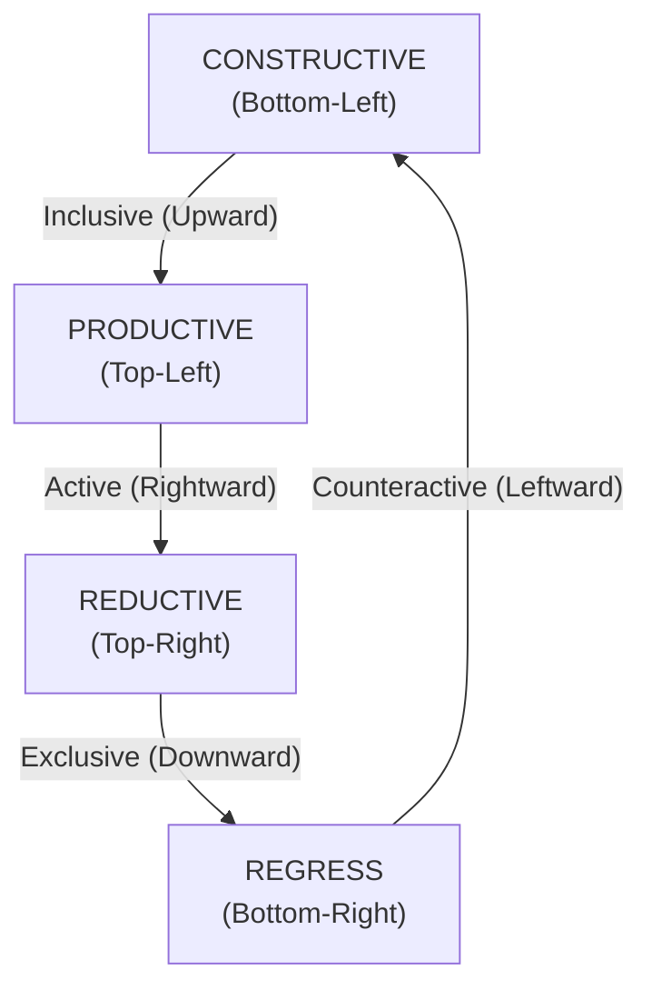
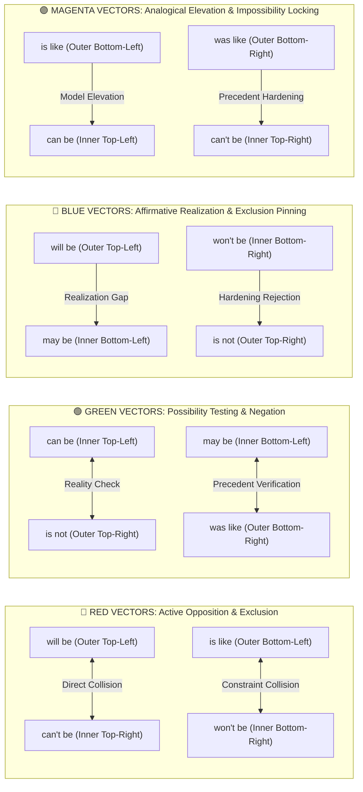
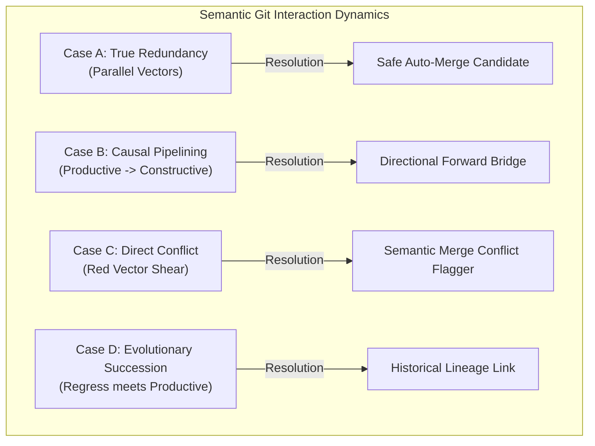

# Semantic Gluon & Dynamic Trajectory Theory
### Modeling Knowledge Documents as Continuous Vector Trajectories Across an Interactive Field

**Author**: VFT Research  
**Date**: 2026-10-24  
**Status**: Foundational Specification & Mathematical Model  
**Location**: [`e:\Vector Field Theory\VFT Docs\_VFT MD\Physics\Semantic_Gluon_and_Dynamic_Trajectory_Theory.md`](file:///e:/Vector%20Field%20Theory/VFT%20Docs/_VFT%20MD/Physics/Semantic_Gluon_and_Dynamic_Trajectory_Theory.md)  
**Mirror**: [`e:\Vector Field Theory\VFT Docs\_Navigation\master_index_plans\semantic_gluon_dynamic_trajectory_theory.md`](file:///e:/Vector%20Field%20Theory/VFT%20Docs/_Navigation/master_index_plans/semantic_gluon_dynamic_trajectory_theory.md)  

---

## 1. Executive Summary & The Failure of Static Embeddings

In conventional Natural Language Processing (NLP) and vector databases, a document is converted into a **single, static embedding vector** (such as a 384- or 1536-dimensional point $\vec{v}$). 

This approach has three fatal flaws:
1. **It collapses progression over time**: A 20-page document does not say one single thing. It starts with an initial observation, builds a working model, critiques opposing approaches, and resolves into concrete actions. Averaging all words into one static vector flattens the entire journey into a meaningless blur.
2. **Vectors have no operational direction**: Standard cosine similarity only measures lexical proximity (whether two files use similar vocabulary). It cannot tell whether Document B **builds**, **executes**, **forbids**, or **archives** Document A.
3. **No relational binding force**: Without directional operators, files sit in an unbonded, chaotic cloud. There is no physics to tell you whether two files should be merged, chained in a sequence, flagged as a direct conflict, or organized into a historical timeline.

The **Semantic Gluon** solves this by treating semantic relationships not as static distances, but as **directional binding forces**. Like gluons in particle physics that bind quarks together by exchanging color charges, the Semantic Gluon carries directional polarity and transformation rules that govern how ideas bond, repel, and transform across an information field.

---

## 2. The Relativity Map: Complete Three-Tier Geometry

The structure of the Semantic Gluon is grounded in the **Relativity Map**. It consists of three nested geometric tiers governed by two global super-axes:

```
                            [ ACTIVE / LATENT ACTIVE ]
                          SOLUTION (Left) │ PROBLEM (Right)
                                          │
   [will be] ─────────────────────────────┼──────────────────────────── [is not]
       │  ▲                               │                                ▲  │
       │   \ [can be] ───────────────► ───┼─── ► [can't be] ──────────────/   │
       │    \     │                       │             │                /    │
       │     \    ▼                       │             ▼               /     │
       │   [PRODUCTIVE] ───────────────┐  │  ┌─────────────── [REDUCTIVE]     │
       │          \                    │  │  │                    /           │
       │           \    ┌──────────────┴──┴──┴──────────────┐    /            │
       │            \   │  ▲                             ▲  │   /             │
INCLUSIVE           ▼   │   \                           /   │  ▼          EXCLUSIVE
 (Left)        [IS] ────┼────►         [ IS ]          ◄────┼──── [IS]     (Right)
       │            ▲   │   /                           \   │  ▲              │
       │           /    │  ▼                             ▼  │   \             │
       │          /     └──────────────┬──┬──┬──────────────┘    \            │
       │         /                     │  │  │                    \           │
       │   [CONSTRUCTIVE] ─────────────┘  │  └──────────────── [REGRESS]      │
       │     /    ▲                       │             ▲               \     │
       │    /     │                       │             │                \    │
       │   / [may be] ◄─────────────── ───┼─── ◄───────── [won't be]      \   │
       │  ▼                               │                                ▼  │
   [is like] ─────────────────────────────┼─────────────────────────── [was like]
                                          │
                        [ COUNTERACTIVE / LATENT COUNTERACTIVE ]
```

### The Global Super-Axes & Boundaries
* **Horizontal Split (X-Axis)**:
  * **Solution (Left / West)**: Affirmative, generative, structural, and constructive.
  * **Problem (Right / East)**: Critical, restrictive, constraining, and falsifying.
* **Vertical Split (Y-Axis)**:
  * **Active / Latent Active (Top / North)**: Forward-driving, live execution, and current force.
  * **Counteractive / Latent Counteractive (Bottom / South)**: Historical grounding, empirical precedent, and archival baseline.
* **Transversal Boundary**:
  * **Inclusive (Left Boundary)**: Connecting parts together, expanding capability, and integrating concepts.
  * **Exclusive (Right Boundary)**: Setting boundaries, excluding invalid paths, and enforcing constraints.

---

### Tier 1: The Ground-State Singularity (`[IS]`)
At the exact center of the map sits the ground state: **`[IS]`**.
* **Role**: The pure observation of reality in the present moment without yet adding judgment, action, or constraint.
* **The 4 Diagonal Ray Channels**: From `[IS]`, four bidirectional channels project diagonally into the four quadrants. Every statement in any text begins by taking `[IS]` and steering it through an operational process toward a modal state.

---

### Tier 2: The Four Operational Transformation Engines (Inner Loop)
Surrounding `[IS]` is a directed, closed perimeter loop connecting the four core transformation engines. The energy flows in a continuous clockwise cycle:

$$\text{Constructive} \xrightarrow{\text{Inclusive}} \text{Productive} \xrightarrow{\text{Active}} \text{Reductive} \xrightarrow{\text{Exclusive}} \text{Regress} \xrightarrow{\text{Counteractive}} \text{Constructive}$$



1. **Constructive Engine (Bottom-Left: Solution + Counteractive)**  
   * **Function**: Takes raw materials, historical precedents, and analogies to build the initial structural framework.  
   * **Plain Language**: *"Here is what the thing is shaped like; here is our structural model."*
2. **Productive Engine (Top-Left: Solution + Active)**  
   * **Function**: Takes the structure and drives it into active execution, generating code, policies, or solutions.  
   * **Plain Language**: *"Here is the action; here is what must be done to bring it to life."*
3. **Reductive Engine (Top-Right: Problem + Active)**  
   * **Function**: Puts the live solution under stress, testing edge cases, identifying failures, and establishing hard boundaries.  
   * **Plain Language**: *"Here is where it breaks; here are the invalid paths we must exclude."*
4. **Regressive Engine (Bottom-Right: Problem + Counteractive)**  
   * **Function**: Takes obsolete or superseded versions and records their historical lineage, storing why they failed for future reference.  
   * **Plain Language**: *"Here is what was tried in the past; here is the legacy record."*

---

### Tier 3: The Eight Modal Boundary States (Dual Corner Nodes)
Each quadrant contains a pair of linked modal states: an **Inner State** (closer to the engine) and an **Outer State** (at the boundary of the field):

| Quadrant | Engine | Inner Modal State | Outer Modal State | Meaning |
| :--- | :--- | :--- | :--- | :--- |
| **Top-Left** (Solution + Active) | **Productive** | **`can be`** | **`will be`** | From recognized capability (`can be`) to definitive realization (`will be`). |
| **Top-Right** (Problem + Active) | **Reductive** | **`can't be`** | **`is not`** | From structural boundary (`can't be`) to observed negation (`is not`). |
| **Bottom-Right** (Problem + Counteractive) | **Regress** | **`won't be`** | **`was like`** | From active refusal (`won't be`) to archived historical memory (`was like`). |
| **Bottom-Left** (Solution + Counteractive) | **Constructive** | **`may be`** | **`is like`** | From permissive hypothesis (`may be`) to grounded physical analogy (`is like`). |

---

## 3. The Four Verbatim Operational Derivation Laws

The Relativity Map is not merely a classification grid; it is a **dynamic calculation engine**. The text at the base of the diagram defines the exact operational laws required to transform the central ground state `[IS]` into any definitive state:

### Law I: The Reductive Law (Defining `IS` as `can't be`)
> **"If you want to define IS as something that can't be you must go through a reductive process using what it was like and can be opposing what its like until it's not"**

* **Target Goal**: Establish a hard boundary or impossibility (`can't be`).
* **Active Engine**: **Reductive process**.
* **Tools Used**: Historical precedent (**`was like`**) + recognized capability (**`can be`**).
* **Force Opposed**: Grounded current analogy (**`is like`**).
* **Stopping Condition**: Complete empirical verification of absence (**`until it's not`**).
* **Application in Knowledge Work**: When auditing an idea or debugging code, you prove an approach is impossible (`can't be`) by taking past test logs (`was like`) and theoretical capacity (`can be`), demonstrating why the current implementation (`is like`) fails, until you establish clear absence of validity (`is not`).

---

### Law II: The Productive Law (Defining `IS` as `will be`)
> **"If you want to define IS as something that will be you must go through a productive process using what is not and is like opposing what it was like until it can be"**

* **Target Goal**: Assert a definitive future delivery or outcome (**`will be`**).
* **Active Engine**: **Productive process**.
* **Tools Used**: Known problem/gap (**`is not`**) + working baseline (**`is like`**).
* **Force Opposed**: Outdated historical legacy (**`was like`**).
* **Stopping Condition**: Demonstrable functional capability (**`until it can be`**).
* **Application in Knowledge Work**: When planning a project or building a feature, you define what will ship (`will be`) by taking the missing requirement (`is not`) and existing codebase structure (`is like`), cutting away obsolete legacy habits (`was like`), until the new feature runs and works (`can be`).

---

### Law III: The Regressive Law (Defining `IS` as `won't be`)
> **"If you want to define IS as something that wont be you must go through a regressive process using what it's not and what it's like to oppose what it can be until it was like"**

* **Target Goal**: Formally abandon or deprecate an approach (**`won't be`**).
* **Active Engine**: **Regressive process**.
* **Tools Used**: Observed failure (**`it's not`**) + current baseline constraints (**`it's like`**).
* **Force Opposed**: Speculative optimism or wishful thinking (**`can be`**).
* **Stopping Condition**: Archiving into historical memory (**`until it was like`**).
* **Application in Knowledge Work**: When deprecating an obsolete tool or rejecting an unproductive path, you declare it will not happen (`won't be`) by citing actual failures (`is not`) and real current limits (`is like`) to counter false hopes (`can be`), until the approach is safely filed away as legacy history (`was like`).

---

### Law IV: The Constructive Law (Defining `IS` as `may be`)
> **"If you want to define IS as something that may be is you must go through a constructive process using what it can be and was like until it is like"**

* **Target Goal**: Formulate a viable hypothesis or exploratory design (**`may be`**).
* **Active Engine**: **Constructive process**.
* **Tools Used**: Identified potential (**`can be`**) + proven historical precedent (**`was like`**).
* **Stopping Condition**: Reaching a grounded, tangible model (**`until it is like`**).
* **Application in Knowledge Work**: When drafting a new theory or research paper, you outline a possible breakthrough (`may be`) by synthesizing future capability (`can be`) with historical lessons (`was like`), iterating until you have a concrete, demonstrable prototype (`is like`).

---

## 4. The Four Colored Force Vectors (Gluon Gauge Fields)

On the Relativity Map, four distinct colored cross-vectors act as **gluon force carriers** mediating interactions across quadrants:



### 1. 🔴 Red Vectors: Active Opposition & Exclusion Strain
* **Paths**:
  * Outer Top-Left (`will be`) $\longleftrightarrow$ Inner Top-Right (`can't be`)
  * Outer Bottom-Left (`is like`) $\longleftrightarrow$ Inner Bottom-Right (`won't be`)
* **Physical Meaning**: This is the line of **maximum structural tension**. It connects an affirmative claim of what will exist or what something resembles directly against the structural constraint forbidding it.
* **Semantic Git Role**: When Document 1 asserts a productive promise (`will be`) and Document 2 asserts that this exact mechanism is impossible (`can't be`), the Red Vector fires. The system flags this as a **Critical Conflict / Contradiction**.

### 2. 🟢 Green Vectors: Possibility Testing & Negation Resolution
* **Paths**:
  * Inner Top-Left (`can be`) $\longleftrightarrow$ Outer Top-Right (`is not`)
  * Inner Bottom-Left (`may be`) $\longleftrightarrow$ Outer Bottom-Right (`was like`)
* **Physical Meaning**: This is the line of **empirical falsification and reality testing**. It tests an unproven capability (`can be`) against the cold fact that it does not currently exist (`is not`), or tests a new hypothesis (`may be`) against historical record (`was like`).
* **Semantic Git Role**: Highlights **Gaps & Research Opportunities**. It flags where a system has theoretical capacity that has not yet been realized in production.

### 3. 🔵 Blue Vectors: Affirmative Realization & Exclusion Pinning
* **Paths**:
  * Solution Side: Outer Top-Left (`will be`) $\longrightarrow$ Inner Bottom-Left (`may be`)
  * Problem Side: Inner Bottom-Right (`won't be`) $\longrightarrow$ Outer Top-Right (`is not`)
* **Physical Meaning**:
  * On the Solution side: Measures the gap between tentative permission (`may be`) and definitive delivery (`will be`).
  * On the Problem side: Pins down active refusal (`won't be`) into an observable permanent absence (`is not`).
* **Semantic Git Role**: Tracks **Execution Maturity**. It shows how tentative plans harden into definitive deliverables.

### 4. 🟣 Magenta / Pink Vectors: Analogical Elevation & Impossibility Locking
* **Paths**:
  * Solution Side: Outer Bottom-Left (`is like`) $\longrightarrow$ Inner Top-Left (`can be`)
  * Problem Side: Outer Bottom-Right (`was like`) $\longrightarrow$ Inner Top-Right (`can't be`)
* **Physical Meaning**:
  * On the Solution side: Lifts a grounded structural analogy (`is like`) into functional capability (`can be`).
  * On the Problem side: Hardens a series of past failures (`was like`) into a permanent structural impossibility rule (`can't be`).
* **Semantic Git Role**: Tracks **Pattern Extraction & Rule Learning**. It records how code patterns become standard libraries, and how past bugs become unit test constraints.

---

## 5. Dynamic Document Trajectories: Continuous Motion Through Topic Space

Documents are not static points in a vector database; **they are paths traveled through an information landscape**.

As a reader moves through a document from start to finish (normalized duration $t \in [0, 1]$), the document continuously changes its topical focus and transitions through the four operational engines:

```
t = 0.0 (Start)                                                        t = 1.0 (End)
    │                                                                       │
    ▼                                                                       ▼
[ Introduction ] ──► [ Architecture ] ──► [ Implementation ] ──► [ Retrospective ]
  CONSTRUCTIVE          PRODUCTIVE             REDUCTIVE              REGRESSIVE
  ("is like")           ("will be")           ("can't be")           ("was like")
  on Topic A            on Topic B             on Topic B             on Topic A
```

### The Mathematical Formulation: The Path Integral of Bond Strength

Let $T_k$ represent any topic or category in the repository. At any point in the text $t \in [0, 1]$, the document exerts:
1. An instantaneous topical attention weight $w_k(t) \ge 0$.
2. An instantaneous Gluon State Vector $\vec{\sigma}_k(t) \in \mathbb{R}^4$:

$$\vec{\sigma}_k(t) = \begin{bmatrix} c_k(t) \\ p_k(t) \\ r_k(t) \\ g_k(t) \end{bmatrix}$$

Where:
* $c_k(t)$ = Constructive charge (`is like` / `may be`)
* $p_k(t)$ = Productive charge (`will be` / `can be`)
* $r_k(t)$ = Reductive charge (`is not` / `can't be`)
* $g_k(t)$ = Regressive charge (`was like` / `won't be`)

The **Total Bond Tensor** $\mathbf{B}_{D, k}$ between Document $D$ and Topic $k$ is the path integral over the entire duration of the document, augmented by its **Inclusive–Exclusive Polarity** and explicit **Acceptance/Negation Ledgers**:

$$\mathbf{B}_{D, k} = \left\langle \int_{0}^{1} w_k(t) \cdot \vec{\sigma}_k(t) \, dt, \;\; \iota_{D,k}, \;\; \mathcal{I}_{D,k}, \;\; \mathcal{E}_{D,k} \right\rangle$$

Where the 4-component operational vector integral is:
$$\vec{\Sigma}_{D,k} = \begin{bmatrix} C_k \\ P_k \\ R_k \\ G_k \end{bmatrix}$$

### 1. The Inclusive–Exclusive Polarity Operator ($\iota_{D,k}$) & Concept Ledgers ($\mathcal{I}, \mathcal{E}$)
Every operational move on the Relativity Map sits on either the **Inclusive (Left: Solution)** hemisphere or the **Exclusive (Right: Problem)** hemisphere:
* **Inclusive Charge ($I_k = C_k + P_k$)**: What the document **includes, accepts, integrates, and builds** into the topic (`is like`, `may be`, `can be`, `will be`).
* **Exclusive Charge ($E_k = R_k + G_k$)**: What the document **discludes, negates, rejects, or deprecates** from the topic (`is not`, `can't be`, `won't be`, `was like`).

The net **Inclusive–Exclusive Polarity** $\iota_{D,k} \in [-1, +1]$ is:
$$\iota_{D, k} = \frac{(C_k + P_k) - (R_k + G_k)}{C_k + P_k + R_k + G_k}$$
* $\iota_{D,k} \to +1$: Purely **Inclusive / Accepting** (expands and affirms the concept).
* $\iota_{D,k} \to -1$: Purely **Exclusive / Negating** (carves away false definitions and enforces boundaries).
* $\iota_{D,k} \approx 0$: **Balanced Boundary Definition** (defines a concept by explicitly pairing what it *includes* against what it *discludes*, e.g., *"$\pi$ is not a static ratio [$\mathcal{E}$]; $\pi$ is the Geometric Exploration Operator [$\mathcal{I}$]"*).

Alongside the scalar polarity, the tensor maintains two explicit symbolic sets for each topic $k$:
* **Included Set $\mathcal{I}_{D,k}$**: The exact propositions, symbols, and mechanisms accepted into the definition of $[IS]$.
* **Discluded Set $\mathcal{E}_{D,k}$**: The exact propositions, symbols, and mechanisms explicitly negated or ruled out from $[IS]$.

### 2. Connection Magnitude (Total Link Strength)
The scalar intensity of the bond between the document and Topic $k$ is:

$$\|\vec{\Sigma}_{D, k}\| = \sqrt{C_k^2 + P_k^2 + R_k^2 + G_k^2}$$

* A large $\|\vec{\Sigma}_{D, k}\|$ means the document devotes significant analytical energy to that topic.
* A near-zero value means the topic was merely mentioned in passing or not at all.

### 3. Spectral Phase (The Nature of the Relationship)
The unit direction of $\vec{\Sigma}_{D, k}$ identifies the operational character of the relationship:
* **High $P_k$ (Productive / Inclusive-Active)**: Actively builds, proves, or executes this topic.
* **High $R_k$ (Reductive / Exclusive-Active)**: Critiques, falsifies, or places hard boundaries on this topic.
* **High $C_k$ (Constructive / Inclusive-Counteractive)**: Provides foundational analogies and structural models.
* **High $G_k$ (Regressive / Exclusive-Counteractive)**: Records deprecated history or abandoned paths.

---

## 6. Semantic DNA & The Gluon Reading Head (Ribosomal Semantics)

Just as a ribosome moves along an mRNA strand reading 3-base codons to synthesize a protein, a **Semantic Gluon Transformer** acts as a lightweight **Reading Head** moving sequentially across a document from $t = 0$ to $t = 1$.

### 1. Semantic Codon Transcription
At each discrete segment (sentence, paragraph, or dialogue turn $i \in \{1, \dots, N\}$), the Reading Head transcribes the text into a compact **Semantic Codon**:

$$\text{Codon}_i = \Big\langle \underbrace{Q_i \in \{C, P, R, G\}}_{\text{Engine Base}}, \;\; \underbrace{M_i \in \{8\text{ Modals}\}}_{\text{Modal State}}, \;\; \underbrace{\iota_i \in [-1, +1]}_{\text{Inc/Exc Polarity}}, \;\; \underbrace{\mathcal{I}_i / \mathcal{E}_i}_{\text{Accepted / Negated}}, \;\; \underbrace{H_i}_{\text{Complexity}} \Big\rangle$$

This converts a massive 4,000-line document into a lightweight **Semantic DNA Strand**—for example:
```
[C:is_like (+I: recursion)] ──► [R:is_not (-E: standard limit)] ──► [C:may_be (+I: INDEF shell)] ──► [P:will_be (+I: X = [x] + x_ε)]
```

### 2. DNA Strand Homology & Sequence Alignment
When two related documents are transcribed into Semantic Gluon chains—such as a raw exploratory dialogue (`chatgpt infinity maths.md`) and its distilled formal paper (`Comprehensive Report - IRM.md`)—their strands can be aligned using sequence alignment (analogous to Needleman–Wunsch / Smith–Waterman DNA alignment):
* **Conserved Regions (Exact Base Matches)**: Points where the exploratory dialogue's constructive/productive codons align directly with the formal report's axioms.
* **Point Mutations (Phase Shifts)**: Places where a tentative hypothesis in Document A (`C: may be`) matured into a definitive law in Document B (`P: will be`).
* **Unmerged Deletions (Missing Data Discovery)**: High-energy Productive or Constructive islands in the raw chat log that have **no aligned counterpart** in the formal report—automatically pinpointing forgotten insights that should be merged!

### 3. Concept Survival, Complexity Waves & Document Maturity (Health Score)
By tracking the Gluon chain over $t \in [0, 1]$ and comparing it against mature baselines (such as peer-reviewed arXiv papers), the Reading Head measures four structural health metrics:
1. **Concept Survival Rate ($S_{\text{survival}}$)**: What fraction of concepts introduced in $\mathcal{I}_t$ survive subsequent Reductive (`can't be` / `is not`) stress-tests without being deprecated into Regressive (`was like` / `won't be`) dead-ends?
2. **Complexity Wave ($H(t)$)**: Tracks whether the document's topical breadth and symbolic density **converge** (shrinking entropy as axioms unify multiple topics, typical of mature papers) or **fragment** (diverging topic count and unresolved reductive loops, typical of breakdown points).
3. **Derivation Law Completeness**: Checks whether claims in the document actually complete the 4 Operational Derivation Laws (e.g., whether a `will be` claim explicitly defines what `is not` and what `is like` while opposing `was like` until `can be`), or whether it makes unsupported leaps.
4. **Maturity Index vs. Reference Corpus**: Measures how closely a draft's Gluon transition matrix ($4 \times 4$ Markov chain between $C, P, R, G$) matches well-formed scientific literature.

---

## 7. The "Semantic Git" Engine: Multi-Document Interaction Physics

When multiple documents ($D_1$ and $D_2$) interact in the knowledge graph, their gluon bond tensors determine their physical relationship:



### Case A: True Redundancy (Safe Merge Candidate)
* **Mathematical Condition**: Both documents have high bond strength to Topic $k$, and their gluon vectors point in the same quadrant:
  $$\frac{\vec{\Sigma}_{D_1, k} \cdot \vec{\Sigma}_{D_2, k}}{\|\vec{\Sigma}_{D_1, k}\| \|\vec{\Sigma}_{D_2, k}\|} \approx 1.0 \quad \text{and} \quad \mathcal{I}_{D_1,k} \cap \mathcal{I}_{D_2,k} \neq \emptyset$$
* **Physical Effect**: Zero tension. Both files are making identical claims using different words.
* **Semantic Git Action**: **Safe Merge Recommendation**. The files can be combined into a single canonical source without losing distinct perspectives.

### Case B: Causal Pipelining (Forward Workflow Chain)
* **Mathematical Condition**: $D_1$ terminates with high Productive charge (`will be` / `can be`), and $D_2$ initiates with high Constructive charge (`is like` / `may be`).
* **Physical Effect**: Smooth laminar flow. $D_1$ creates the output that $D_2$ uses as its baseline.
* **Semantic Git Action**: **Causal Bridge**. The visualizer draws a directed green bridge connecting $D_1 \to D_2$. The system warns: *"Do not merge; $D_2$ depends on $D_1$."*

### Case C: Semantic Merge Conflict (Red Vector Shear & Inclusion/Exclusion Clash)
* **Mathematical Condition**: $D_1$ asserts a Productive claim on Topic $k$ (`will be`) or includes proposition $X \in \mathcal{I}_{D_1, k}$, while $D_2$ asserts a Reductive boundary (`can't be`) or discludes the same proposition $X \in \mathcal{E}_{D_2, k}$.
* **Physical Effect**: Maximum shear stress across the central `[IS]` gate ($\mathcal{I}_{D_1, k} \cap \mathcal{E}_{D_2, k} \neq \emptyset$).
* **Semantic Git Action**: **Conflict Flagger**. The system warns:
  > *"Conflict Detected: Document 1 includes/asserts Proposition X, whereas Document 2 explicitly discludes/negates X. Re-alignment required."*

### Case D: Evolutionary Succession & DNA Gap Recovery
* **Mathematical Condition**: $D_1$ (e.g. a raw exploratory dialogue) aligns along a shared Semantic DNA backbone with $D_2$ (e.g. a formal synthesis report), where early tentative states in $D_1$ (`may be` / `can be`) mature into definitive states in $D_2$ (`is like` / `will be`), while certain high-charge islands in $D_1$ remain unaligned in $D_2$.
* **Physical Effect**: Evolutionary distillation with identifiable **unmerged semantic genes**.
* **Semantic Git Action**: Maps the shared homology backbone and highlights the exact unmerged islands in $D_1$ for topic recovery.

---

## 8. Visual Integration in Landscape Mode (`Master_Index.html`)

This theoretical framework translates directly into the visual interface of the **Landscape Mode**:

1. **Topic Rooms as Attractor Basins**:
   * Instead of flat Windows filesystem folders, room tiles represent semantic attractors. Files naturally orbit the topics they bond to most strongly.
2. **Color-Coded Semantic Bridges**:
   * SVG connectors between rooms or files reflect their dominant gluon force:
     * **Green Bridges**: Productive / forward causal pipelines.
     * **Blue Bridges**: Constructive structural relationships.
     * **Red / Pulsing Bridges**: Direct semantic conflicts or high-strain contradictions.
     * **Amber / Dashed Bridges**: Historical lineage and deprecated versions.
3. **Document Trajectory Sparklines & DNA Strips**:
   * Inside the in-HTML document reader, a miniature trajectory sparkline shows the reader's path through the 4 quadrants ($t = 0 \to 1$), alongside its Inclusive (`+I`) vs. Exclusive (`-E`) balance and Concept Survival score.
4. **The Semantic Git Overlay**:
   * A side panel in the Master Index providing instant visibility into topic overlap, DNA strand alignment between drafts and reports, unmerged insights, and active theoretical conflicts across the 5,000+ files in the repository.

---

## 9. Summary of Terms & Formulas

* **Ground State**: `[IS]` — Pure presence and baseline observation.
* **Four Engines**: `Constructive` $\to$ `Productive` $\to$ `Reductive` $\to$ `Regress`.
* **Eight Modal States**:
  * Solution (Inclusive): `will be` (outer), `can be` (inner), `may be` (inner), `is like` (outer).
  * Problem (Exclusive): `is not` (outer), `can't be` (inner), `won't be` (inner), `was like` (outer).
* **Inclusive–Exclusive Polarity**:
  $$\iota_{D, k} = \frac{(C_k + P_k) - (R_k + G_k)}{C_k + P_k + R_k + G_k} \in [-1, +1]$$
  paired with Accepted/Included Set $\mathcal{I}_{D,k}$ and Negated/Discluded Set $\mathcal{E}_{D,k}$.
* **Semantic DNA Codon (Reading Head Step $i$)**:
  $$\text{Codon}_i = \langle Q_i \in \{C, P, R, G\},\; M_i,\; \iota_i,\; \mathcal{I}_i,\; \mathcal{E}_i,\; H_i \rangle$$
* **Four Colored Forces**:
  * 🔴 **Red**: `will be` $\longleftrightarrow$ `can't be` · `is like` $\longleftrightarrow$ `won't be` (Active opposition).
  * 🟢 **Green**: `can be` $\longleftrightarrow$ `is not` · `may be` $\longleftrightarrow$ `was like` (Possibility testing).
  * 🔵 **Blue**: `will be` $\to$ `may be` · `won't be` $\to$ `is not` (Realization tension).
  * 🟣 **Magenta**: `is like` $\to$ `can be` · `was like` $\to$ `can't be` (Elevation & locking).
* **Total Bond Tensor**:
  $$\mathbf{B}_{D, k} = \left\langle \int_0^1 w_k(t) \cdot \vec{\sigma}_k(t) \, dt, \;\; \iota_{D,k}, \;\; \mathcal{I}_{D,k}, \;\; \mathcal{E}_{D,k} \right\rangle$$
