# Implementation Plan v31: Partisan Media Audit & Systematic Quarantine Strategy

## 1. Executive Summary & Problem Formulation

The recent investigation into the James Talarico audit (`talarico-texas-schools`) exposed a critical systemic vulnerability in the automated evaluation pipeline:
* **The Vulnerability**: When ingestion feeds harvest stories from partisan outrage outlets (specifically Fox News, Breitbart, NY Post, etc.), the pipeline is vulnerable to **Opposition Research Laundering** and **Manufactured Outrage Inversion**.
* **The Failure Mode**: The evaluator treats an outlet's weaponized hit piece (e.g., an "unearthed 6-year-old clip" dropped as "FIRST ON FOX" during a high-stakes campaign) as a legitimate, breaking policy announcement about the targeted individual. The bot naively audits the targeted figure on the outlet's manipulated terms, awards the outlet/system an unearned PASS, and awards the victim a false FAIL.
* **The Mandate**: 
  1. **Immediate Priority**: Audit and sanitize the **Queue** (all staged/unposted stories in `stories/`, candidates in `harvested_candidates.json`, and darkroom).
  2. **Next Priority**: Systematically audit the **Live Database** (`stories/live/`) across all right-wing media posts to measure the true extent of the compromise.
  3. **Establish Remediation & Quarantine Protocols**: Formulate clear rules on whether compromised posts must be quarantined, re-audited, corrected, or systematically taken down from Bluesky.

---

## 2. Forensic Audit Taxonomy: How We Audit

To ensure evaluations are rigorous, substrate-neutral, and objective, every candidate story must be audited across four strict forensic dimensions:

### Dimension 1: Event Type & Origin Forensics
* **Primary Event**: Concrete, falsifiable institutional action (e.g., legislation passed, court ruling, agency report, budget enactment, verified physical event).
* **Secondary Weaponization (Oppo-Dump / Outrage Laundering)**:
  - Markers: "Unearthed clip", "FIRST ON FOX", "slams", "resurfaced remarks", "under fire for past comments", "social media erupts", "pundit panel reaction".
  - Timing: Released during an election cycle, confirmation battle, or legislative deadline.
  - Age: Event/quote occurred months or years prior, revived solely for political extraction.

### Dimension 2: Target Attribution & Vector Alignment
* **Actor Misattribution**: Did the audit evaluate the *subject being smeared* as the primary actor driving the negative vector, rather than the *outlet manufacturing the smear*?
* **Stated vs. Actual Separation**: Did the audit take the outlet's headline as the "Stated Ideal" rather than recognizing it as a partisan pretext?

### Dimension 3: The Three Pillars Verification
* **Institutional Actions**: Does the audit reflect what institutions actually did (e.g., statutes enacted, actual court filings, state budget figures)?
* **Empirical Reality**: Does the verbatim text/quote support the headline, or does the article contradict its own sensationalized framing?
* **Human Impacts**: Does the audit focus on real human suffering/empowerment (e.g. school funding, child mental health, crime victims) or does it get trapped in cable-news culture-war theater?

### Dimension 4: Social Physics Loop Diagnostics
* **Smart Selfish Loop Identification**:
  $$\text{Secret Goal (Electoral Advantage / Ad Revenue)} \longrightarrow \text{Pretext (Defending Standards / Saving Children)} \longrightarrow \text{Projection / Scapegoat (Candidate Hates Academics)}$$
* **Integrity Inversion**: Did the audit reward the Pretext with a PASS and punish the Scapegoat with a FAIL? If yes, the audit is **CRITICALLY COMPROMISED**.

---

## 3. Two-Tier Operational Plan

```mermaid
flowchart TD
    subgraph Tier1["Tier 1: The Queue (Immediate Priority - Zero Public Impact)"]
        Q1["Scan stories/, darkroom, harvested_candidates.json"] --> Q2["Filter Right-Wing & Oppo-Dump Stories"]
        Q2 --> Q3["Run Automated Forensic Screening"]
        Q3 --> Q4{"Classification"}
        Q4 -->|Critically Compromised / Oppo| Q5["Quarantine to stories/quarantine/"]
        Q4 -->|Clean / Legitimate Event| Q6["Retain for Review"]
        Q5 --> Q7["Re-evaluate with HIGH Thinking Budget or Purge"]
    end

    subgraph Tier2["Tier 2: The Live Database (Next Priority - Public Record)"]
        L1["Scan all 13,500+ stories in stories/live/"] --> L2["Extract all Fox News & Right-Wing Media Stories"]
        L2 --> L3["Forensic Screening for False Verdicts & Oppo Markers"]
        L3 --> L4["Generate Comprehensive Audit Dossier"]
        L4 --> L5["User Strategic Review & Decision Gate"]
        L5 -->|Option A: Takedown| L6["ATProto Scripted Thread Deletion"]
        L5 -->|Option B: Correction| L7["Issue Root Thread Correction Notice"]
        L5 -->|Option C: Local Quarantine| L8["De-index from Web Dashboard Only"]
    end
```

---

## 4. Phase-by-Phase Execution Protocol

### Phase 1: Tier 1 Queue Audit & Quarantine (Immediate)
1. **Target Scope**:
   * Staged story configs in `bluesky_bot/stories/` (currently 32 staged files).
   * Unprocessed candidates in `bluesky_bot/harvested_candidates.json`.
   * Darkroom staging in `bluesky_bot/stories/darkroom/`.
2. **Action**:
   * Inspect every file originating from targeted domains: `foxnews.com`, `breitbart.com`, `nypost.com`, `washingtonexaminer.com`, `dailywire.com`, `freebeacon.com`, `thefederalist.com`, `theblaze.com`, `newsmax.com`, `oann.com`.
   * Screen for secondary weaponization markers ("unearthed clip", "resurfaced", "blasts", "slams").
   * Move suspect/compromised files into a dedicated quarantine folder (`bluesky_bot/stories/quarantine/`) so they cannot be posted live by any automated batch run.
   * Present full itemized queue inventory to the user.

### Phase 2: Tier 2 Live Database Audit (Forensic Inventory)
1. **Target Scope**:
   * Complete inventory of `bluesky_bot/stories/live/` (~13,548 files).
2. **Action**:
   * Run a read-only Python extraction script to catalog every live story from targeted right-wing outlets.
   * Extract: Story ID, Subject, Publisher, Stated/Actual Coordinates, Verdict, Hypocrisy ($R_{\text{net}}$), and Bluesky Post URLs/rkeys.
   * Classify stories into three buckets:
     * **Bucket A (Clean / Empirically Grounded)**: Straightforward reporting of primary events (e.g. US Coast Guard recruiting figures, official indictments) where coordinates reflect real institutional actions.
     * **Bucket B (Suspect / Partisan Framing)**: Heavy ideological spin or culture-war framing, but factual core may be salvageable.
     * **Bucket C (Critically Compromised / False Verdict)**: Blatant opposition dump or manufactured outrage laundering where the victim was failed and the smear was rewarded.
   * Output full quantitative report and summary breakdown to the user in chat.

### Phase 3: Strategic Takedown & Correction Decision Gate
Based on the results of Phase 2, present the user with concrete remediation options:
1. **Systematic ATProto Takedown**:
   * Write an explicit, audited script (`takedown_compromised_posts.py`) that deletes specific rkeys from Bluesky via `client.com.atproto.repo.delete_record`.
   * **Mandatory Guardrail**: Must print the exact list of URLs to be deleted and require explicit user confirmation before executing.
2. **Batch Thread Correction**:
   * Post unified correction notes for high-visibility compromised threads.
3. **Database Quarantine**:
   * Set `"quarantined": true` in `stories/live/` configs and strip from public registries (`stories_registry.js`) without touching Bluesky directly.

---

## 5. Architectural Guardrails & Invariants
* **Strict Read-Only Discovery**: No deleting, moving, or modifying live files or Bluesky records during audit and discovery.
* **Safe Deletion Guardrail**: Zero implicit deletions. Every takedown command must be explicitly reviewed and confirmed by the user.
* **Zero Disruption to Clean Content**: Stories from neutral or factual reporting must not be disturbed.
