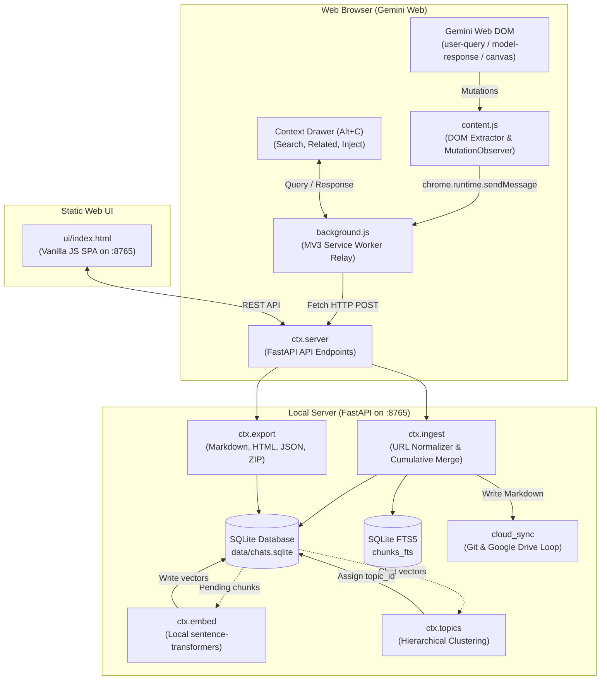
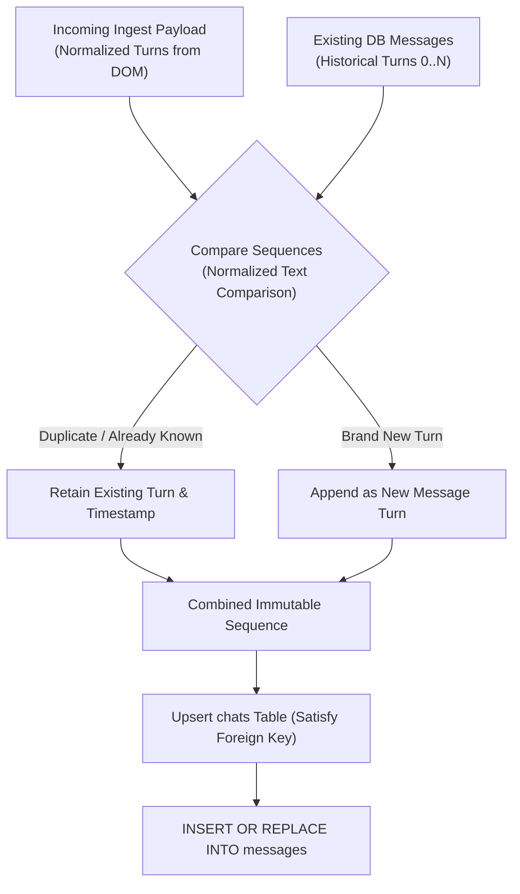

# 03. Architecture & How It Works

This technical guide explains how **Chat Context** works under the hood: data flow, database structure, search algorithms, and synchronization loops.

---

## 1. High-Level System Architecture



---

## 2. Core Subsystems

### Subsystem A: The Browser Extension (Manifest V3)
Google Gemini web pages enforce strict **Content Security Policies (CSP)** that prevent scripts on the page from directly calling arbitrary local ports like `http://127.0.0.1:8765`.

1. **Content Script (`content.js`)**:
   - Injected into `https://gemini.google.com/*`.
   - Uses a `MutationObserver` on `document.body` with a 2-second debounce timer to observe incoming messages and streaming responses.
   - Uses a 1-second SPA URL polling loop to detect conversation switches.
   - Extracts structured conversation turns from custom elements (`<user-query>`, `<model-response>`).
   - Extracts canvas documents from Gemini markdown elements (`.artifact-container`, `iframe.markdown-canvas-iframe`).
2. **Background Service Worker (`background.js`)**:
   - Acts as a privileged relay. When `content.js` calls `chrome.runtime.sendMessage()`, `background.js` executes the actual `fetch()` call to `http://127.0.0.1:8765`.
   - Because extensions possess independent origin privileges, requests to local ports are completely exempt from page CSP headers.

---

### Subsystem B: Database Schema (`ctx/db.py`)
All data resides in a single, robust SQLite database (`data/chats.sqlite`). Foreign key constraints are enforced (`PRAGMA foreign_keys = ON`).

```sql
-- 1. High-level conversation metadata
CREATE TABLE IF NOT EXISTS chats (
    id TEXT PRIMARY KEY,               -- Canonical ID: e.g. gemini-424c86baff31945d
    source TEXT NOT NULL,              -- gemini, claude, chatgpt, antigravity
    title TEXT NOT NULL,
    started TEXT,                      -- ISO 8601 timestamp
    updated TEXT,                      -- ISO 8601 timestamp
    n_msgs INTEGER DEFAULT 0,
    src_mtime REAL DEFAULT 0,
    topic_id INTEGER REFERENCES topics(id),
    topic_locked INTEGER DEFAULT 0,    -- 1 if manually assigned by user
    emb BLOB,                          -- 384-dimensional chat centroid embedding
    url TEXT                           -- Normalized web URL
);

-- 2. Individual conversation messages
CREATE TABLE IF NOT EXISTS messages (
    chat_id TEXT NOT NULL REFERENCES chats(id) ON DELETE CASCADE,
    idx INTEGER NOT NULL,              -- Sequential turn index (0, 1, 2...)
    role TEXT NOT NULL,                -- user, assistant, system
    ts TEXT,
    text TEXT NOT NULL,
    PRIMARY KEY (chat_id, idx)
);

-- 3. Chunked excerpts for fine-grained search
CREATE TABLE IF NOT EXISTS chunks (
    id INTEGER PRIMARY KEY AUTOINCREMENT,
    chat_id TEXT NOT NULL REFERENCES chats(id) ON DELETE CASCADE,
    idx INTEGER NOT NULL,
    text TEXT NOT NULL,
    emb BLOB                           -- 384-dimensional chunk vector
);

-- 4. Full-text search inverted index (FTS5)
CREATE VIRTUAL TABLE IF NOT EXISTS chunks_fts USING fts5(
    text,
    chat_id UNINDEXED,
    content='chunks',
    content_rowid='id'
);

-- 5. Extracted canvas artifacts
CREATE TABLE IF NOT EXISTS canvases (
    id TEXT PRIMARY KEY,
    chat_id TEXT NOT NULL REFERENCES chats(id) ON DELETE CASCADE,
    title TEXT NOT NULL,
    content TEXT NOT NULL,
    type TEXT,
    file_path TEXT,
    updated TEXT NOT NULL
);

-- 6. Dynamic topic clusters
CREATE TABLE IF NOT EXISTS topics (
    id INTEGER PRIMARY KEY AUTOINCREMENT,
    name TEXT NOT NULL,
    user_named INTEGER DEFAULT 0
);
```

---

### Subsystem C: Non-Destructive Cumulative Merge Protocol

When Gemini renders a long conversation, its frontend virtualizes the DOM to conserve RAM. Earlier turns (messages 1 through 50) are unmounted and disappear from the page when you are at the bottom.

To prevent partial DOM snapshots from deleting earlier history, [`ctx/ingest.py`](file:///e:/Vector%20Field%20Theory/VFT%20Docs/chat_context/ctx/ingest.py) uses a **non-destructive cumulative merge algorithm**:



1. Existing turns from SQLite are loaded into memory: `existing_msgs`.
2. Any duplicate legacy alias shells (e.g. from earlier random hash IDs) are identified, and their messages are merged into `existing_msgs`.
3. `merge_messages()` aligns incoming turns against historical turns.
4. The canonical `chats` record is upserted **first** so foreign key constraints are satisfied.
5. All turns are committed back to `messages` without running `DELETE FROM messages`.
6. Result: **Zero data loss**, even across infinite virtualized scrolls.

---

### Subsystem D: The Local AI Embedding Pipeline

Chat Context uses the open-source **`sentence-transformers/all-MiniLM-L6-v2`** embedding model:
- Runs locally on your computer's CPU.
- Converts text into **384-dimensional dense vectors**.
- Stored as compact binary blobs (`np.float32.tobytes()`).

#### Background Embedding Worker
When new chats are ingested, text chunks are marked as pending (`emb IS NULL`). A background thread wakes up every 120 seconds (or immediately on manual sync) to:
1. Batch up un-embedded chunks.
2. Run vector encoding through `all-MiniLM-L6-v2`.
3. Store chunk embeddings in the `chunks` table.
4. Compute the chat's centroid embedding (the average vector across all chunks in the conversation) and update `chats.emb`.
5. Run `INSERT INTO chunks_fts(chunks_fts) VALUES('rebuild')` to keep the SQLite FTS5 index 100% synchronised with zero index corruption.

---

### Subsystem E: Hybrid Search Engine (`ctx/search.py`)

When you submit a query in the dashboard or extension drawer, Chat Context runs a two-pronged search:

1. **Exact Keyword Score ($S_{\text{FTS}}$)**:
   - Queries `chunks_fts` using SQLite FTS5 with BM25 ranking.
   - Normalized between 0.0 and 1.0.
2. **Semantic Similarity Score ($S_{\text{Vector}}$)**:
   - Encodes the user's query into a 384-dimensional vector using `all-MiniLM-L6-v2`.
   - Calculates the cosine similarity against all chunk vectors in memory:
     $$S_{\text{Vector}} = \frac{\mathbf{q} \cdot \mathbf{v}}{\|\mathbf{q}\| \|\mathbf{v}\|}$$
3. **Hybrid Score Fusion**:
   $$S_{\text{Hybrid}} = 0.6 \cdot S_{\text{Vector}} + 0.4 \cdot S_{\text{FTS}}$$
4. **Recency Weighting**:
   When sorting by `Recent`, a smooth time-decay multiplier is applied based on the chat's last update timestamp, boosting fresh conversations while maintaining relevance.
5. **Grouping**:
   - `Chat Grouping`: Groups all matching chunks under their parent chat and takes the top score.
   - `Paragraph Grouping`: Renders each paragraph as an independent search result.

---

### Subsystem F: Canvas Extraction & Cloud Sync

Whenever Gemini produces a canvas, Chat Context extracts it directly from the DOM:
1. **Sanitization**: Strips UI export buttons ("Contents Share & Export Create") from titles and text.
2. **Disk Storage**: Writes the document to `chat_context/canvases/<Chat_Name>/<Canvas_Title>.md`.
3. **Database Indexing**: Records the canvas in the `canvases` SQLite table.
4. **Configurable Cloud Sync (`ctx/cloud_sync.py`)**:
   Backups are debounced (30-second delay) and driven by a local configuration file (`config.json`):
   - **Git Auto-Backup**: Automatically stages and commits new or modified canvases to your configured Git remote repository and branch.
   - **Google Drive Sync**: Automatically converts markdown files to native Google Docs using Pandoc and syncs them to your designated Google Drive folder via Rclone.
   - **Zero Hardcoded Secrets**: Settings and folders are configured interactively via `python setup_sync.py` or stored in a git-ignored `config.json` (with `config.example.json` provided for clean repository sharing).

---

### Subsystem G: Export Suite Engine (`ctx/export.py`)

The export suite generates clean deliverables on the fly:
- **Streaming Responses**: Uses FastAPI's `Response` with `Content-Disposition: attachment; filename=...` headers.
- **In-Memory ZIP Archives**: Uses Python's `zipfile` with `io.BytesIO` to package hundreds of chats in seconds without touching temporary disk storage.
- **Path Deduplication**: An automated path registry ensures no collisions occur if two chats share identical titles or canvas names.
