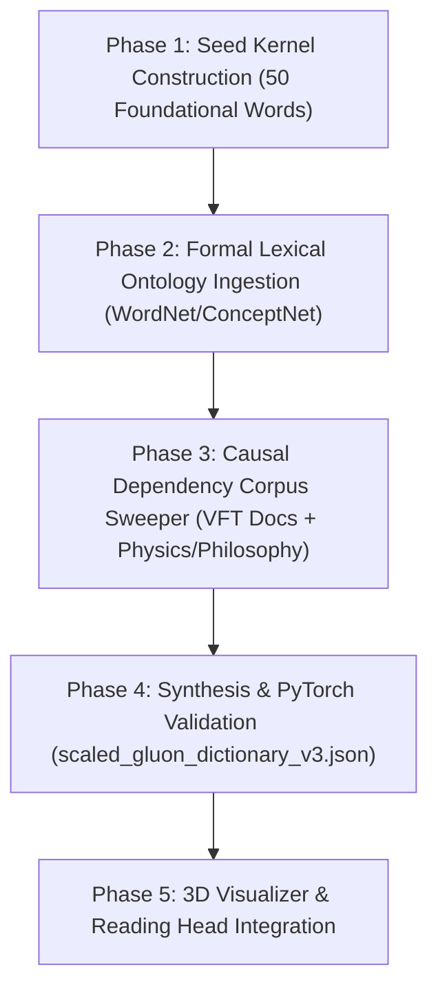

# Implementation Plan: Multidimensional AE-C Semantic Gluon Dictionary (v3)
### Grounding Vocabulary in Event Physics, 7-Plane Projections, and 3D Causal Valence Cubes

**Plan Version**: `v6`  
**Date**: 2026-10-25  
**Status**: Ready for Execution  
**Project Folder**: [`e:\Vector Field Theory\VFT Docs\polytrope_transformer\plans\`](file:///e:/Vector%20Field%20Theory/VFT%20Docs/polytrope_transformer/plans/)  
**Document Link**: [`PLAN_20261025_v6_Multidimensional_AEC_Semantic_Gluon_Dictionary.md`](file:///e:/Vector%20Field%20Theory/VFT%20Docs/polytrope_transformer/plans/PLAN_20261025_v6_Multidimensional_AEC_Semantic_Gluon_Dictionary.md)  

---

## 1. Executive Summary & Objective

The forensic audit of `scaled_gluon_dictionary_v2.json` demonstrated that naive regex scraping on raw English text produced catastrophic errors:
1. It inverted conservation laws (e.g. *"Energy cannot be created or destroyed"* tagged `created` and `destroyed` as forbidden clashes).
2. It tagged everyday conversational verbs as forbidden (e.g. `you` forbidding `choose`, `read`, `serve`).
3. Core foundational words (`energy`, `system`, `force`, `matter`) were left with **zero guaranteed causal links**.

This plan outlines the architecture and execution steps to build **`scaled_gluon_dictionary_v3.json`**. 

Every word in `v3` is modeled strictly according to:
- **[`Treatise_on_How_Words_Work.md`](file:///e:/Vector%20Field%20Theory/VFT%20Docs/_VFT%20MD/Treatise_on_How_Words_Work.md)**: Words as purpose-built tools with an invariant **Action $\xrightarrow{\text{Strain}}$ Effect ($AE\text{-}C$)** kernel.
- **[`Semantic_Gluon_and_Dynamic_Trajectory_Theory.md`](file:///e:/Vector%20Field%20Theory/VFT%20Docs/_VFT%20MD/Physics/Semantic_Gluon_and_Dynamic_Trajectory_Theory.md)**: Directional gluon binding forces across 5 relational bond tiers ($+W, +A, +L, -X, -N$) and 4 colored gauge fields.
- **[`Semantic_Luminescence_and_Causal_Valence_Networks.md`](file:///e:/Vector%20Field%20Theory/VFT%20Docs/_VFT%20MD/Physics/Semantic_Luminescence_and_Causal_Valence_Networks.md)**: The 3D Bounding Cube where height ($Z$) is the **Potential Spectrum from Impossible ($p = 0$) to Certain ($p = 1$)**, depth ($Y$) is **Upstream vs Downstream Valence**, and width ($X$) is **Inclusive Solution vs Exclusive Problem**.

---

## 2. Invariant Data Schema for Dictionary v3

Each word entry in `scaled_gluon_dictionary_v3.json` will follow this exact JSON structure:

```json
{
  "word": "energy",
  "substrate_neutral_definition": "The capacity to apply directional work against resistance across a gradient.",
  "topological_boundary": "Enclosure", // Wall (|), Pocket (⊂), Enclosure (□)
  "fundamental_operation": "HOLD_AND_RELEASE", // IN, OUT, HOLD, BLOCK, MAKE, UNMAKE
  "conjugate_pair": {
    "opposing_root": "entropy",
    "dynamic_balance": "Energy drives ordered work; entropy disperses ordered work into ambient ground state."
  },
  "action_triad": {
    "inception": "Boundary engagement confronting resistance (initial state difference / potential stored).",
    "transit": "Directional gradient flow overcoming friction/strain across distance or cycles.",
    "arrival": "Resolved stable state of altered order (work accomplished, state transition locked)."
  },
  "plane_projections": {
    "Q1_Metaphysical": { "manifest": "will_intent", "description": "Conscious drive applied against despair to maintain character." },
    "Q2_Possible": { "manifest": "capital_optionality", "description": "Uncommitted liquidity held in reserve to fund future choices." },
    "Q3_Physical": { "manifest": "joules_work", "description": "Force exerted across spatial distance (W = F · d)." },
    "Q4_Lyrical": { "manifest": "narrative_tension", "description": "Suspense built across character conflict resolving into catharsis." },
    "Q5_Logical": { "manifest": "computational_flops", "description": "Clock cycles shifting register bits against algorithmic complexity." },
    "Q6_Historical": { "manifest": "institutional_momentum", "description": "Accumulated societal energy driving legislative or cultural changes." },
    "Q7_Emotive": { "manifest": "vitality_passion", "description": "Somatic energy driving psychological focus and emotional expression." }
  },
  "cube_valence": {
    "upstream_prerequisites": [
      { "target": "potential_gradient", "p_cond": 0.96, "role": "State asymmetry enabling flux" },
      { "target": "boundary_separation", "p_cond": 0.94, "role": "Barrier maintaining the gradient" }
    ],
    "downstream_consequences": [
      { "target": "work_output", "p_cond": 0.98, "role": "State displacement achieved" },
      { "target": "thermal_dissipation", "p_cond": 0.92, "role": "Entropy tax on physical transfer" }
    ],
    "potential_spectrum": {
      "certain_invariants": [
        { "target": "conservation_law", "p": 1.0, "tier": "+W", "law": "dE/dt = 0 in closed boundary" }
      ],
      "possible_modes": [
        { "target": "kinetic_motion", "p": 0.85, "tier": "+A" },
        { "target": "stored_charge", "p": 0.70, "tier": "+A" },
        { "target": "radiation_flux", "p": 0.65, "tier": "+A" }
      ],
      "impossible_floor": [
        { "target": "perpetual_motion", "p": 0.0, "tier": "-X", "shear": "Work without gradient depletion" },
        { "target": "creation_ex_nihilo", "p": 0.0, "tier": "-X", "shear": "Spontaneous mass-energy appearance" },
        { "target": "lossless_friction", "p": 0.0, "tier": "-X", "shear": "Resistance without heat tax" }
      ],
      "category_preclusions": [
        { "target": "moral_sin", "p": 0.0, "tier": "-N", "boundary": "Energy is substrate physics; not agentic morality" }
      ]
    }
  },
  "vector_duality": {
    "order_vector_plus_u": "Constructive deployment to build, heal, empower, and sustain systemic life.",
    "chaos_vector_minus_u": "Extractive weaponization to dominate, coerce, destroy, or loot."
  }
}
```

---

## 3. Four-Phase Execution Roadmap



### Phase 1: Seed Kernel Construction (50 Foundational Roots)
- Hand-calibrate the 50 most fundamental physical, mathematical, relational, and cognitive roots using the **5-Stage De-Substrating Sieve**:
  - *Physical/System*: `energy`, `system`, `force`, `matter`, `space`, `time`, `boundary`, `entropy`, `work`, `gradient`.
  - *Topological Operations*: `store`, `flow`, `bind`, `split`, `shield`, `open`, `close`, `hold`, `make`, `break`.
  - *Cognitive/Aletheic*: `truth`, `claim`, `proof`, `evidence`, `witness`, `measure`, `observe`, `kneel`, `rule`, `will`.
- Output: `kernel_seed_50.json` (100% verified ground truth).

### Phase 2: Formal Lexical Ontology Ingestion (WordNet & ConceptNet)
- Write an automated bridge script (`tools/build_lexical_ontology.py`):
  - Extract hypernyms (genus) $\to$ **Guaranteed (+W)**.
  - Extract holonyms/meronyms (parts/wholes) $\to$ **Upstream Prerequisites ($-Y$)**.
  - Extract antonyms and incompatibilities $\to$ **Impossible Floor ($-X$)** and **Precluded Category ($-N$)**.
- This guarantees zero empty `guaranteed` lists and prevents grammatical verbs from being misclassified as contradictions.

### Phase 3: Causal Dependency Corpus Sweeper
- Write a dependency-based sentence parser (`tools/causal_dependency_sweeper.py`):
  - Use SpaCy or Stanza SVO (Subject-Verb-Object) extraction.
  - Parse causal connectors:
    - `"A leads to B"`, `"A produces B"`, `"A causes B"` $\implies B \in \text{Downstream}(A)$.
    - `"A requires B"`, `"A depends on B"`, `"without B, A cannot"` $\implies B \in \text{Upstream}(A)$.
    - Recognize conservation rules: `"A cannot be created"` $\implies \text{A.conservation} = \text{invariant}$, NOT `A forbids created`.
- Sweep across `E:\Vector Field Theory\VFT Docs\_VFT MD\`.

### Phase 4: Synthesis & PyTorch Validation
- Merge Phase 1, Phase 2, and Phase 3 into **`scaled_gluon_dictionary_v3.json`** (500 words).
- Run PyTorch unit tests on [`src/polytrope_layers.py`](file:///e:/Vector%20Field%20Theory/VFT%20Docs/polytrope_transformer/src/polytrope_layers.py):
  1. **Law I Test**: Ensure string tension $T(u, v) \to \infty$ and attention $\alpha(u, v) < 10^{-4}$ on all `impossible_floor` ($-X$) pairs.
  2. **Law II Test**: Ensure derivation completeness loss $\mathcal{L}_{\text{complete}} < 10^{-4}$ on all `upstream_prerequisites` $\to$ `word` $\to$ `downstream_consequences` chains.

### Phase 5: 3D Visualizer & Reading Head Integration
- Update [`semantic_gluon_3d_visualizer.html`](file:///e:/Vector%20Field%20Theory/VFT%20Docs/semantic_gluon_3d_visualizer.html) to dynamically load any word from `scaled_gluon_dictionary_v3.json`.
- Users can select or search any word in the dictionary and fly through its full 3D potential cube, inspect its 7-plane rotations, and watch the Ribosomal Reading Head traverse its derivation paths.

---

## 4. Verification Criteria & Deliverables

1. **Clean Deliverable File**:
   - `e:\Vector Field Theory\VFT Docs\_VFT MD\Physics\semantic_gluon_dna\agent_lexicon_kernel\scaled_gluon_dictionary_v3.json`
2. **Zero Inverted Verb Errors**:
   - Verify that `you`, `system`, `energy`, `truth` contain ZERO conversational verbs in their `impossible_floor`.
3. **100% Non-Empty Grounding**:
   - Every physical root (`energy`, `system`, `matter`, `space`, `force`) has $\ge 3$ verified `upstream_prerequisites` and $\ge 2$ `certain_invariants`.
4. **PyTorch Integration**:
   - Training scripts in `polytrope_transformer` load `v3` without schema errors and achieve zero gradient anomalies.

---

## 5. Next Steps

1. Review and approve this plan.
2. Begin Phase 1: Author the 50-word foundational seed kernel in strict $AE\text{-}C$ format.